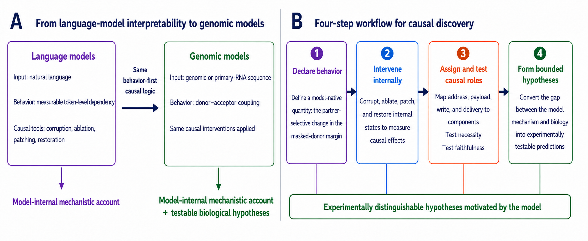

# Mechanistic Discovery in Genomic Foundation Models

Methods, code and evidence for working out what genomic foundation models compute. We start from a model
behavior with a biological reading, then use controlled interventions to find the information,
components and paths that produce it. SpliceBERT is the main worked example.

Start with [the project story](docs/README.md). Then: [mechanism](docs/MECHANISM.md) ·
[results](docs/RESULTS.md) · [studies](studies/README.md) · [reproduction guide](docs/REPRODUCE.md)



*Conceptual overview. The full [seven-stage method](docs/METHODOLOGY.md#the-seven-stage-workflow) adds
assay preflight, controls and replication. [Figure sources](figures/experiment_workflow.provenance.json).*

## Main result

On 400 canonical short-intron examples from the sealed chromosome 8/9 test split, replacing the paired
acceptor's `AG` with `CC` lowers the masked-donor margin by 0.872 logit units (95% CI [0.771, 0.969]).
Matched non-partner controls are near zero. The margin is `logit(G) − max(logit(A), logit(C), logit(T))`
at the masked donor `G`. See [C1–C2](studies/splicebert_partner_selection/CLAIMS.md#1-the-behaviour-and-its-specificity)
and the [recorded result](results/splicebert_coupling/sealed_test.json).

Interventions split the computation into four roles:

| Role | Supported account |
|---|---|
| Address | L3H1 selects the paired acceptor mainly through positional information; L2H15 strengthens the attention-side signal. |
| Payload | Earlier heads and MLPs build causally relevant values in a four-token acceptor window. Their biological meaning is unresolved. |
| Write | L3H1 combines address and payload into a donor-local state, captured well by a tested rank-8 subspace. |
| Delivery | Later heads, including L4H0, L4H2 and L5H11, carry that state to the masked-token output through their value-output paths. |

These components are a structured, top-ranked causal core within distributed computation under the
tested interventions. They are not a complete or autonomous circuit (C27), and minimality is not claimed. The held-out ranking curve has no sparse
knee, though that does not prove no smaller circuit exists. The learned period-3 positional direction and
the boundary-register preference seen in fixed-span chimeras are separate findings; no experiment yet
connects them, identifies reading frame, or establishes a cellular splicing mechanism. A DNABERT-2
promoter study gives a bounded comparison with a different, MLP-heavy core, and is not a replication.

Claim ledgers and result artifacts are the record. Summaries like this one do not override them.
Attention, attribution, probes and spectra nominate candidates; only intervention shows causal use, and
a causal model mechanism is not automatically a biological one.

## Reproduce and validate

Check the artifact registry, with no model weights or third-party packages:

```bash
python3 scripts/verify_manifest.py
```

Install the locked environment and run the tests:

```bash
uv sync --locked --extra splicebert --extra biology --extra dev
uv run --locked --extra splicebert --extra biology --extra dev pytest
```

The full provenance checks need Git history and archive tags. Model checkpoints, the hg38 FASTA and the
GENCODE annotation are obtained separately, and tests that need them report skips. Passing tests is not a
rerun of the model experiments. [docs/REPRODUCE.md](docs/REPRODUCE.md) covers dependencies, data,
commands and the limits of exact reproduction.

## Repository layout

| Directory | Contents |
|---|---|
| [`docs/`](docs/README.md) | The project story, mechanism, results, methods, reproduction and contribution guides |
| [`studies/`](studies/README.md) | Each study's claim ledger, corrections, protocols and decisions |
| [`results/`](results/) | Immutable results, manifests and audits |
| [`src/gfmcd/`](src/gfmcd/) | Model adapters, reusable circuit tools and study assays |
| [`scripts/`](scripts/README.md) | Experiment, audit and figure entry points by study |
| [`figures/`](figures/README.md) | Publication figures and their provenance |
| [`tests/`](tests/) | Analysis tests, evidence-integrity checks and regression guards |

To add a study or change the record, see [docs/CONTRIBUTING.md](docs/CONTRIBUTING.md). The live manuscript
source is kept outside this repository; [docs/RESULTS.md](docs/RESULTS.md) audits a fingerprinted draft.

Code is under the [MIT License](LICENSE). External model and data terms are in
[docs/REPRODUCE.md](docs/REPRODUCE.md#third-party-assets-and-licenses).
