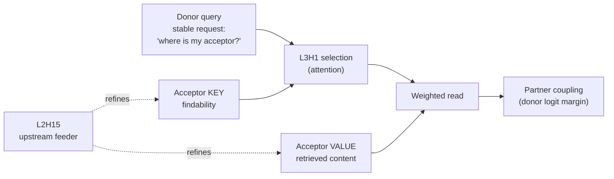

# Mechanism of same-intron boundary coupling

All numbers are **gene-disjoint held-out** (val = chr11/16/19). Test (chr8, chr9) is SEALED.

## The claim

> **L3H1 implements an acceptor-side, content-addressed read: the acceptor must be both
> *identifiable* through its key and *informative* through its value. Together those two
> channels explain 87% of the head's recoverable causal effect.**

This is a mechanistic result, not a localisation result. It is substantially stronger than
"L3H1 attends to splice sites" — which is roughly what the attention analysis in the
original SpliceBERT paper already implies.

## The circuit



## The evidence

### 1. Selection collapses under corruption

L3H1's attention from the donor to the partner acceptor:

| condition | attention |
|---|---|
| intact | **0.652** |
| **acceptor corrupted** | **0.029** — 95% collapse |
| L2H15 ablated | 0.515 — 21% collapse |
| distance-matched control position | 0.0007 |

### 2. The read is CONJUNCTIVE (K x V), not additive

Patch L3H1's key / value at the acceptor's AG window, clean -> corrupt:

| patch | coupling recovered |
|---|---|
| key only | 0.035 [-0.015, +0.084] |
| value only | 0.104 [+0.074, +0.138] |
| **key + value** | **0.711 [+0.669, +0.751]** |
| query @ donor | 0.003 |
| key / value @ control position | 0.000 |

**Paired factorial interaction** (the statistic to report -- the 5x *ratio* is descriptive
but unstable, because the marginals are small and their ratio is noisy):

```
I = R_KV - R_K - R_V + R_null        (R_null = 0: no patch, no recovery)
I = 0.711 - 0.035 - 0.104 = +0.573   [+0.522, +0.624]
                                     gene-grouped bootstrap, per example
```

Mechanically:
* **key only** -> the head can now FIND the acceptor, but retrieves the CORRUPT value. It
  reads the wrong thing.
* **value only** -> the correct content is present, but attention has collapsed 95%, so the
  head NEVER LOOKS AT IT.
* **both** -> it finds the partner *and* reads it -> 0.711, which is **87% of the 0.819**
  recovered by patching the entire head output.

That K and V multiply is built into the transformer and is not itself surprising. What is
scientifically load-bearing is that the interaction:
* is **localised to the actual AG window** (`[a-2, a-1]`),
* is **absent at matched control positions** (0.000),
* **mediates nearly all** of L3H1's causal effect (87%),
* operates on the **donor-acceptor relationship identified by the biological assay**.

### 3. L2H15 is an upstream feeder

| | |
|---|---|
| marginal ablation drop | +0.600 |
| extra drop **given L3H1 already ablated** | **+0.051** [+0.025, +0.082] |
| => nested inside L3H1 | **92%** |
| recovery from patching its clean output | **0.001** [-0.007, +0.009] — zero |
| cos(key at acceptor, with vs without L2H15) | 0.950 |
| cos(value at acceptor, with vs without L2H15) | 0.929 |

L2H15 is **necessary but carries no separable partner signal** (its clean output patches back
0.001).

### The rescue (`l2_rescue.json`) -- route measured, not inferred

Ablate L2H15, then restore L3H1's key / value at the acceptor to their **L2H15-intact**
values, and ask how much of the coupling L2H15 supplies (+0.725) comes back:

| restore | coupling rescued |
|---|---|
| **key only** | **0.423** [+0.358, +0.503] |
| **value only** | **-0.019** [-0.030, -0.011] |
| key + value | 0.405 [+0.341, +0.480] |
| MLP2 write @ acceptor | 0.276 [+0.229, +0.330] |
| key+value @ control position | -0.002 |

**L2H15 acts on the acceptor's KEY, not its VALUE.** Value rescue is zero; K+V adds nothing
over K alone. So L2H15 is a **findability / addressing** head: it builds the key that lets
L3H1 *locate* the partner acceptor. It does not shape the content L3H1 retrieves.

> **RETRACTED (this document, earlier revision):** "L2H15 refines both the key and the value."
> That was inferred from cosine similarity (k 0.950, v 0.929), which pointed at the VALUE as
> the more perturbed channel -- and was **causally wrong**. Cosines rank perturbation
> magnitude, not causal relevance. Only the rescue settles it.

**Two honest limits:**

1. The key route accounts for only **~40%** of L2H15's effect. The remaining ~60% is
   **unidentified** -- it does not enter through L3H1's key or value at the acceptor
   (control: -0.002). It may act at other positions, on other heads, or downstream of L3.
   Do not describe the L2H15 -> L3H1 route as complete.
2. **MLP2 mediates 28%** [23%, 33%] -- modest and real, not a clean null. The signal travels
   *primarily* through the residual stream, but MLP2 is not irrelevant. **No transcoder** (28%
   does not justify a research branch), but do not report "MLP2 does not mediate".

## Two precision points that constrain the wording

1. **Do not report the 5x ratio.** Report the interaction `I = +0.573 [+0.522, +0.624]`.
2. **`query@donor = 0.003` is a null about the CORRUPTION, not about the query.** Acceptor
   corruption did not perturb the donor's query, so a clean-query patch has nothing to
   restore. The donor query may well be the stable "where is my acceptor?" request; its
   **necessity is untested** and requires *corrupting or replacing* it (D8).

### 4. Address and content are SEPARABLE -- this is BINDING (`competing_acceptors.json`)

Within-sequence double dissociation. Swap L3H1's key / value between the true partner
acceptor and a **distance-matched decoy AG** in the same window. No corruption; the sequence
stays clean.

| condition | attn -> PARTNER | attn -> DECOY | donor margin | partner effect lost |
|---|---|---|---|---|
| baseline | 0.505 | 0.009 | 4.655 | 0% |
| **key-swap** | **0.009** | **0.505** | 4.200 | **50%** |
| **value-swap** | **0.505** | 0.009 | 4.200 | **50%** |
| **both-swap** | 0.009 | **0.505** | **4.655** | **0%** |

* **key-swap** -> attention moves *entirely* to the decoy. **The key is the address.**
* **value-swap** -> attention stays *exactly* on the partner, and the margin still collapses.
  It looks in the right place and reads the wrong thing. **The value is the content.**
* **both-swap** -> attention sits on the **decoy**, yet the margin is **fully restored** --
  because the true partner's value travelled with the key.

**The head does not care WHERE it reads from. It cares WHAT it reads, and the key is purely
what routes it there.** Address and content are independently manipulable.

The corroborating patch table (`qkv.json`) shows the same thing from the corruption side:

| patch | attention restored | coupling restored |
|---|---|---|
| none (corrupt) | 0.029 | 0.000 |
| key only | **0.525 (80%)** | 0.035 |
| value only | 0.029 (0%) | 0.104 |
| key + value | **0.525 (80%)** | **0.711** |
| clean reference | 0.652 | 1.000 |

Key restores **selection** but not the conclusion; value restores **neither** alone.

> This licenses the claim **"L3H1 BINDS a donor to a PARTICULAR acceptor through separable
> address and content representations"** -- not merely "L3H1 reads an acceptor". It is the
> biological circuit this project set out to find, reached only after two forced-choice
> designs (v1, v2) were retracted as degenerate.

## What is still open

* **~60% of L2H15's effect is unidentified** (D11). The key route accounts for 0.423 of the
  +0.725 it supplies. Do not describe the L2H15 -> L3H1 route as complete.
* **The donor query's necessity is untested** (D8). `query@donor = 0.003` is a null about the
  CORRUPTION, not the query.
* **Only short introns fit the 1024nt context** -- the intron-coupling result cannot be
  generalised to typical (long) human introns.
* What makes the acceptor's key encode "*I am THIS donor's partner*" rather than "*I am an
  AG*"? The decoy is a distance-matched AG and it is *not* selected, so the key already
  carries partner-specific address information. Where that comes from is the next question.
